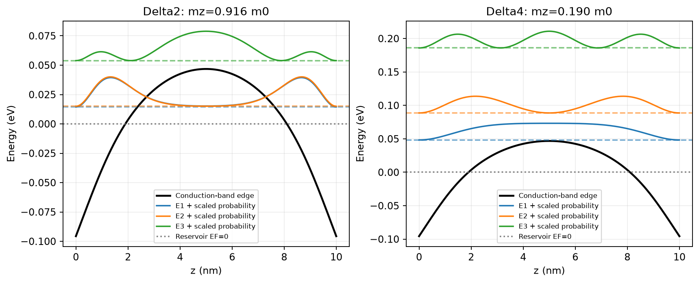
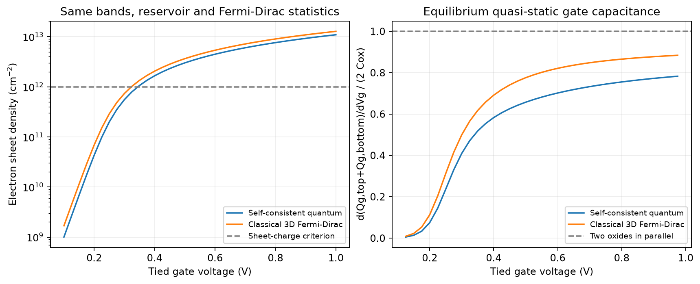
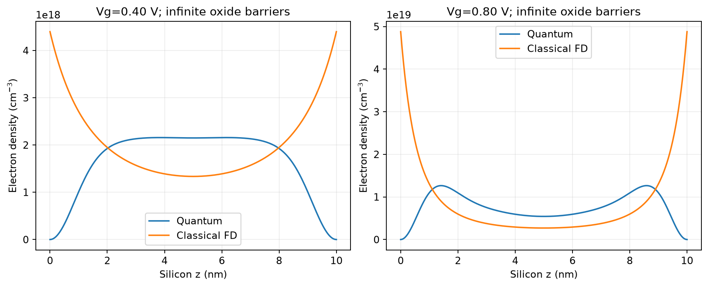
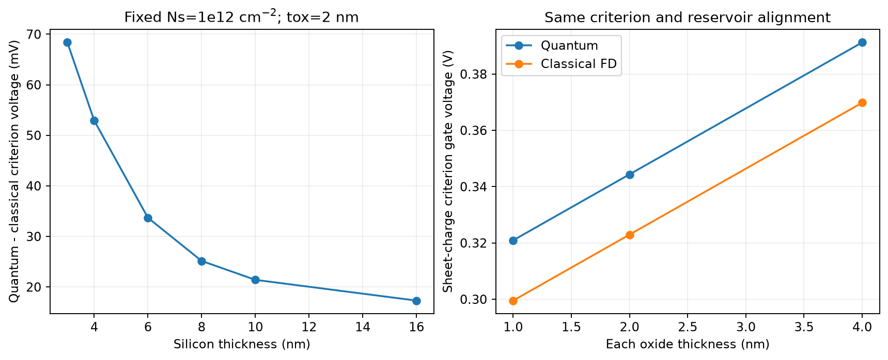
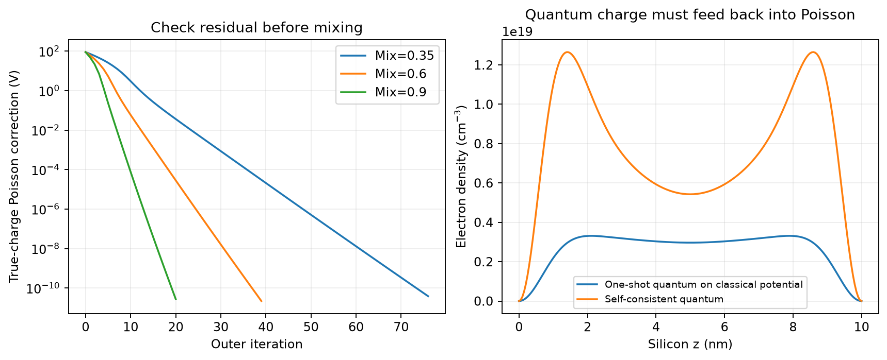
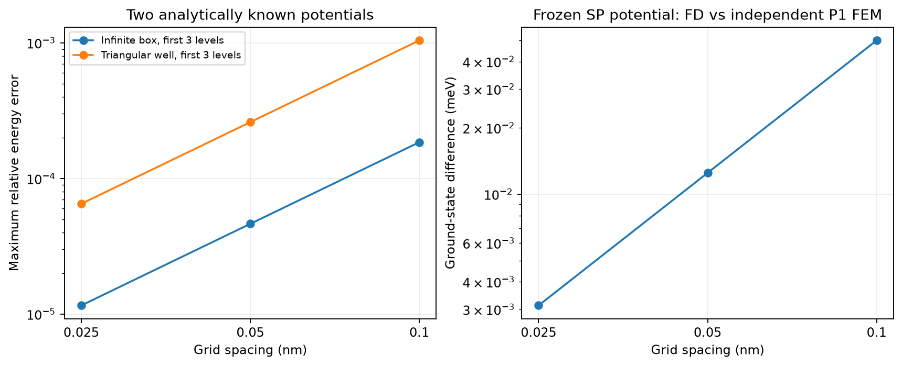

# mini-tcad-schrodinger-poisson

**Schrödinger–Poisson（薛定谔–泊松）自洽：薄硅 MOS 的量子限域、能谷占据、电荷质心与栅电容。**

这是第五个教学型 TCAD（Technology Computer-Aided Design，工艺与器件计算机辅助设计）项目，接在 [PN 结](https://github.com/carveself/mini-tcad-pn)、[经典 MOS 电容](https://github.com/carveself/mini-tcad-moscap)、[漂移-扩散](https://github.com/carveself/mini-tcad-drift-diffusion)和[二维 MOSFET 静电学](https://github.com/carveself/mini-tcad-mosfet-2d)之后。MOS（Metal-Oxide-Semiconductor，金属-氧化物-半导体）这里采用上下栅短接的 (001) 薄硅结构，电子与一个固定费米能的侧向电荷库保持热平衡。

Quantum confinement（量子限域）使垂直运动形成离散能级，面内运动仍连续。本项目把这些能级的电子占据反馈给电势，研究经典模型与量子模型为什么会得到不同的电荷与电容。



## 一键运行

Python 3.10 或更新版本：

```bash
git clone https://github.com/carveself/mini-tcad-schrodinger-poisson.git
cd mini-tcad-schrodinger-poisson
python -m venv .venv
# macOS / Linux
source .venv/bin/activate
# Windows PowerShell 则使用：.venv\Scripts\Activate.ps1
python -m pip install -r requirements.txt
python run_all.py
python -m unittest discover -s tests -v
```

自动保存 **8 张图、10 个 CSV、1 个 NPZ 和 3 个 JSON**；默认实验和 **16 项测试**已实际运行。默认网格 0.05 nm、每组能谷保留 32 个态；程序不弹出绘图窗口。默认输出为项目内 `figures/`，重复运行覆盖同名数据。

```bash
python run_all.py --spacing 0.025 --output reproduction/fine
python src/stages.py baseline --output reproduction/01-baseline
python src/stages.py verify --output reproduction/02-verification
python src/stages.py feedback --output reproduction/03-feedback
python src/stages.py geometry --output reproduction/04-geometry
```

验证会再细化到所选间距的一半；单元数上限为 2400。自定义相对输出路径相对于执行命令的目录。

## 新概念与用途

| 概念 | 英文全称、中文含义与本项目用途 |
| --- | --- |
| Schrödinger equation | 薛定谔方程；求垂直限域的能级与包络波函数 |
| Poisson equation | 泊松方程；由电子和已电离受主电荷更新电势 |
| EMA | Effective Mass Approximation，有效质量近似；用抛物能带与有效质量描述低能电子 |
| Subband | 子带；垂直离散能级加上连续面内动能形成的一组态 |
| Valley degeneracy | 能谷简并度；计算等价硅导带能谷的统计权重 |
| DOS | Density of States，态密度；把子带能量与费米统计转换为电子数 |
| Fermi–Dirac statistics | 费米–狄拉克统计；考虑电子占据限制，量子与经典对照都使用它 |
| Hartree self-consistency | 哈特里自洽；电子电荷通过静电势反馈到自身的单粒子哈密顿量 |
| Charge centroid | 电荷质心；这里定义为电子到最近硅/介质界面的平均距离 |
| Quasi-static capacitance | 准静态电容；每个邻近栅压重新达到平衡后，对总栅电荷作数值微分 |

“经典”对照是同一能谷质量、同一温度和同一电荷库下的 **三维局域费米–狄拉克模型**，并非玻尔兹曼近似。这样可以更清楚地区分空间量子化与载流子统计的作用。

## 完成的研究内容

1. (001) 硅的 Δ2、Δ4 两组能谷：不同量子化质量、面内态密度质量、2/4 重能谷权重，自旋不重复计算。
2. 有限差分薛定谔方程、保守节点体积泊松方程、两端氧化层 Robin 边界及真正的电荷反馈。
3. 37 个栅压点，比较量子/经典面密度、准静态栅电容、最近界面质心和能谷占据。
4. 六种硅厚、三种氧化层厚度，在同一电子面密度判据下提取栅压偏移。
5. 无限深方阱与 Airy 三角阱解析能级；独立线性有限元的广义特征值对照。
6. 网格、态数、电容微分步长、混合比例和偏压路径检查；另用联合非线性求根检查自洽解。
7. 对比“一次量子后处理”与完整自洽，说明为什么波函数画出来还不等于量子电容算对。



## 基准结果

硅厚 10 nm，每侧介质厚 2 nm，300 K，固定完全电离受主 1e16 cm⁻³。电荷库费米能取 0，零参考电势下导带边为 0.35 eV，栅参考偏移为零。这个导带对齐是给定参数，不由受主浓度推算；栅参考偏移也不冒充完整 MOS 的实验平带电压。

Vg=0.8 V 时：

| 量 | 自洽量子 | 经典三维 FD |
| --- | ---: | ---: |
| 电子面密度 | 7.62753e12 cm⁻² | 9.02403e12 cm⁻² |
| 到最近界面平均距离 | 2.41141 nm | 1.28425 nm |
| 两栅总准静态电容 | 0.0260837 F/m² | 0.0298920 F/m² |

量子模型 Δ2 最低子带约 0.0144432 eV、Δ4 约 0.0482378 eV，均相对于同一 EF=0。Δ2 占总电子面密度约 58.30%，不能仅按能谷数 2/6 分配，因为限域能量与面内态密度也参与竞争。



在对称双栅下，全膜的平均 z 总是 tSi/2，无法显示电子是否远离界面。代码改用 `积分 n(z)*min(z,tSi-z) / 积分 n(z)`；这是“最近界面距离”，并不是全膜几何中心。

## 同电荷判据的电压偏移

定义电子面密度 Ns=1e12 cm⁻² 的栅压，默认器件量子/经典分别为 0.344363/0.322953 V，差约 **+21.41 mV**。它是明确的面电荷判据，不是默认等同于实测阈值、恒流阈值或普适量子阈值偏移。



薄硅限域更强，判据偏移更明显。另一个结果是：在固定相同 Ns、硅厚、受主与对齐条件后，1/2/4 nm 三种介质的量子/经典偏移均约 21.41 mV。对称结构两侧总电荷相同，两模型增加的氧化层压降相同，因此偏移主要是同电荷下的硅表面电势差；它不随本模型的 tox 改变。这个结论依赖无限量子势垒和理想平面介质，不是所有真实器件的普适结论。固定 Vg 而非固定 Ns 时，改变 tox 仍会改变电荷和限域场。

## 为什么一定要自洽

把经典电势固定，只解一次薛定谔方程，默认 0.8 V 的电子面密度约 2.64043e12 cm⁻²；完整量子自洽为 7.62753e12 cm⁻²，单次后处理低约 65.38%。量子电荷减少会改变屏蔽与势阱，必须继续反馈。



外循环每次重新解两组能谷和费米占据，内循环用局域指数预测器稳定更新泊松。预测器只是迭代预条件，不是最终电荷模型。停止时同时检查未乘混合比例的更新和使用真实量子电荷计算的泊松电压修正，避免小混合比例造成假收敛。

## 验证证据及各自的范围



| 检查 | 基准结果，约值 |
| --- | ---: |
| 方阱最后一级能量误差阶 | 1.99998 |
| h=0.025 nm 的 Airy 前三态最大相对误差 | 6.50e-5 |
| h=0.025 nm，冻结自洽电势后的 FD/FEM 基态差 | 0.00313 meV |
| h=0.05 → 0.025 nm，量子面密度相对变化 | 0.00172% |
| 0.25 nm 网格，预测器迭代/联合求根的最大电势差 | 约 3e-12 V |
| 默认全栅压扫描最大泊松电压修正 | 小于 4e-11 V |
| 默认全栅压扫描最大相对电荷平衡误差 | 约 3.01e-8 |

有限元只交叉检查**同一个给定电势下**的谱，不是另一套完整自洽离散。联合求根用另一种非线性算法，但仍共享同一离散方程。守恒也部分来自保守装配；这些小数值误差不等于对真实器件有同样精度。

态数实验在冻结自洽电势下进行。4 态缺约 0.908% 面电荷；16/32/48 态在该基准下已接近浮点误差。末尾保留态占据很小只是截断诊断，不能单独当作所有未保留态的严格误差界。

## 两种“电容”不能混用

准静态栅电容为 `d(Qg,top+Qg,bottom)/dVg`，每次偏压都重新自洽；双栅平行氧化层参考为 2Cox≈0.0345313 F/m²。

`summary.json` 还给出冻结势阱/谱时的热力学量子电容 `q*dNs/dEF(eV)`，默认约 0.414829 F/m²。它不是栅端测得的电容；完整栅响应还受到氧化层和分布电荷质心、静电反馈的影响，不能直接把该数字标成 Cg。

## 教程、报告与范围

- [分阶段复现](docs/REPRODUCE.md)：从方阱到自洽、验证和自己的扩展。
- [方程与数值细节](docs/MODEL.md)：单位、简并度、两组质量、统计与边界。
- [验证记录](docs/VALIDATION.md)：测试、误差与原始数据路径。
- [项目报告](docs/REPORT.md)：问题、方法、结果、局限。
- [复试口述和追问](docs/INTERVIEW.md)：英文简介与关键推导问题。

模型是平衡、电子单载流子、无限势垒、有效质量和 Hartree 静电近似；受主固定完全电离，不解空穴，不含交换关联、有限氧化层波函数渗透、隧穿、原子能带、谷分裂或非平衡输运。薄硅与高场结果用于比较该模型内的趋势。它不是完整 MOS 的积累—耗尽—反型全范围模型，也不计算漏电流或实验频率响应；无实验室数据。

基准已在 Python 3.12、NumPy 2.3.5、SciPy 1.18.1、Matplotlib 3.11.2 环境运行。参考实现和数据由工具辅助制作；复现时如实记录自己重写、排错和扩展的部分。能讲清楚验证与局限，比只背一组漂亮结果更有用。

## 参考资料

- [QTCAD：部分限域、自洽与子带占据的理论说明](https://docs.nanoacademic.com/qtcad/theory_spin_fem/schrodinger_poisson/)。本项目为独立 Python 教学实现，不使用或声称复现其商业软件结果。
- [TU Wien：硅/介质界面电子限域](https://www.iue.tuwien.ac.at/phd/ungersboeck/node51.html)。
- [TU Wien：(001) 硅两组子带阶梯与质量方向](https://www.iue.tuwien.ac.at/phd/ungersboeck/node53.html)。
